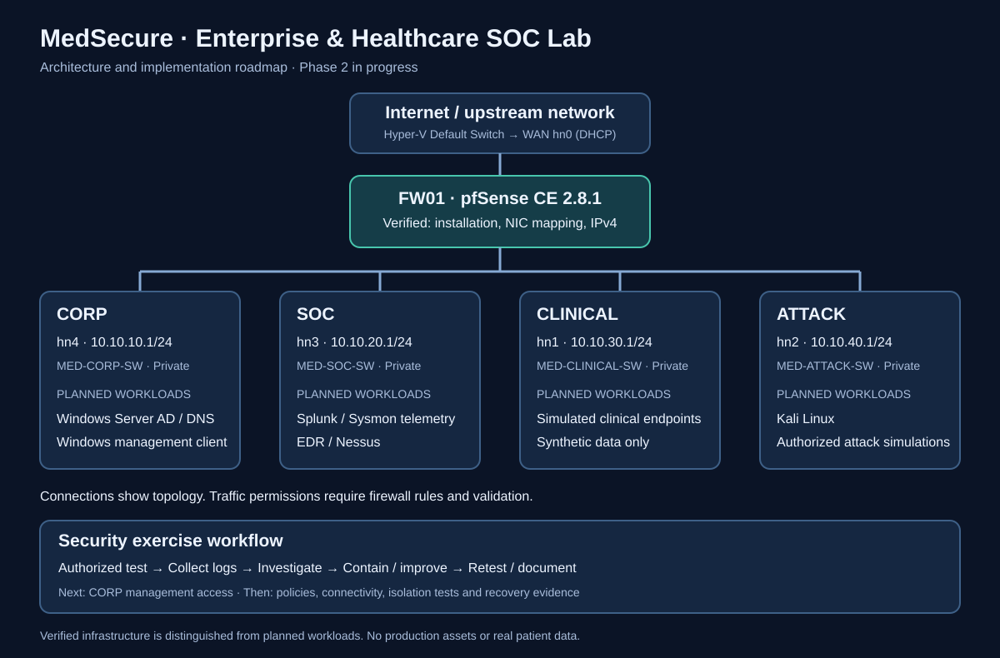

# MedSecure — Segmented Enterprise & Healthcare SOC Home Lab

**Platform:** Microsoft Hyper-V · pfSense CE 2.8.1 · Ubuntu 24.04.5 LTS management workstation · planned Windows infrastructure · SOC tooling  
**Progress:** Phase 1 firewall installation verified; Phase 2 network segmentation in progress: all five interface assignments verified; all internal gateway addresses verified; MED-UBUNTU-01 installation and desktop boot verified; management access and policy validation pending.

## Mission
Build a realistic, isolated enterprise and simulated clinical security environment to demonstrate network architecture, segmentation, identity management, endpoint monitoring, SIEM analysis, detection engineering, incident response, vulnerability management and recovery. No real patient data or production assets are used.

## Portfolio map

[Explore the project map and build sequence](docs/09-portfolio-map.md).

## Current architecture
| Zone | Hyper-V switch | pfSense NIC | Address / status |
|---|---|---|---|
| WAN | Default Switch | hn0 | DHCP; latest observed 172.28.254.188/20 |
| CORP | MED-CORP-SW | hn4 | 10.10.10.1/24 — configured |
| SOC | MED-SOC-SW | hn3 | 10.10.20.1/24 — configured |
| CLINICAL | MED-CLINICAL-SW | hn1 | 10.10.30.1/24 — configured |
| ATTACK | MED-ATTACK-SW | hn2 | 10.10.40.1/24 — configured |

The internal switches are Hyper-V **Private** switches. The host does not automatically have access to them. The CORP management VM, renamed from CORP-WS01 to **MED-UBUNTU-01**, now runs **Ubuntu Desktop 24.04.5 LTS** on MED-CORP-SW. Installation, ISO detachment, login and desktop boot are screenshot-verified; guest hostname, IP configuration and pfSense web access are not yet verified.

## Completed and verified
- Assessed GHOST host (Intel N95, 4 cores, ~32 GB RAM, NVMe storage).
- Confirmed firmware virtualization enabled and Hyper-V operation.
- Created four dedicated private switches.
- Provisioned FW01 with five adapters and deterministic MAC addresses.
- Mapped WAN hn0, CORP hn4, SOC hn3, CLINICAL hn1 and ATTACK hn2 by MAC.
- Diagnosed an ISO attachment/readability boot error and subsequently booted the Netgate installer.
- Installed pfSense Community Edition 2.8.1 on a 20 GB Hyper-V virtual disk using GPT and ZFS single-disk stripe.
- Observed successful boot, WAN DHCP address and CORP gateway 10.10.10.1/24.
- Installed Ubuntu Desktop 24.04.5 LTS on MED-UBUNTU-01; verified login and desktop boot; detached installer ISO.

## Documentation
- [Project objectives and success criteria](docs/01-objectives-and-scope.md)
- [Architecture, assets, MAC and IP plan](docs/02-architecture.md)
- [Phase 1 build journal and troubleshooting](docs/03-build-journal.md)
- [Screenshot evidence register](docs/04-evidence-register.md)
- [Implementation roadmap](docs/05-roadmap.md)
- [Troubleshooting records](docs/06-troubleshooting.md)
- [Verification matrix and boot evidence](docs/07-verification.md)
- [Phase 2 network segmentation journal](docs/08-phase-02-network-segmentation.md)
- [Ubuntu endpoint deployment journal](docs/10-ubuntu-endpoint-deployment.md)

## Next milestone
Verify Ubuntu guest hostname and IP address (`hostnamectl`, `ip -br a`, `ip route`), then test pfSense management connectivity, configure least-privilege firewall policies and preserve a known-good backup.

## Evidence and publication policy
**30 sanitized Phase 1 screenshots are published**, organized into host baseline, Hyper-V networking, pfSense installation and boot verification. **26 Phase 2 screenshots are published**: 17 firewall and VM setup screenshots in the [Phase 2 journal](docs/08-phase-02-network-segmentation.md), plus nine installation and boot screenshots in the [Ubuntu deployment journal](docs/10-ubuntu-endpoint-deployment.md). Browse the [evidence register](docs/04-evidence-register.md#published-screenshot-inventory). Remove emails, account names, device IDs, secrets, tokens, personal paths and unrelated private information before committing images. Never publish ISO files, VHDX disks, credentials or clinical information.

**Maintainer:** Ayobami Odulaja

## Verified milestone

The console verifies installation and initial WAN/CORP addressing. Later segmentation, client connectivity and SOC tooling remain roadmap milestones.
