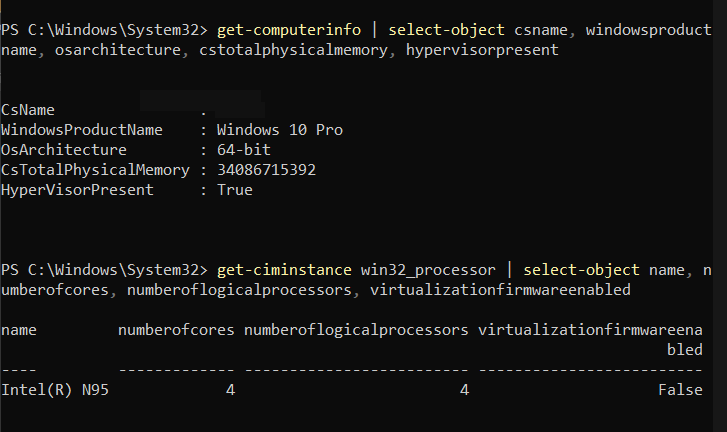
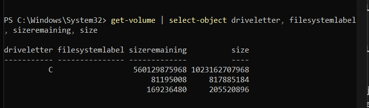
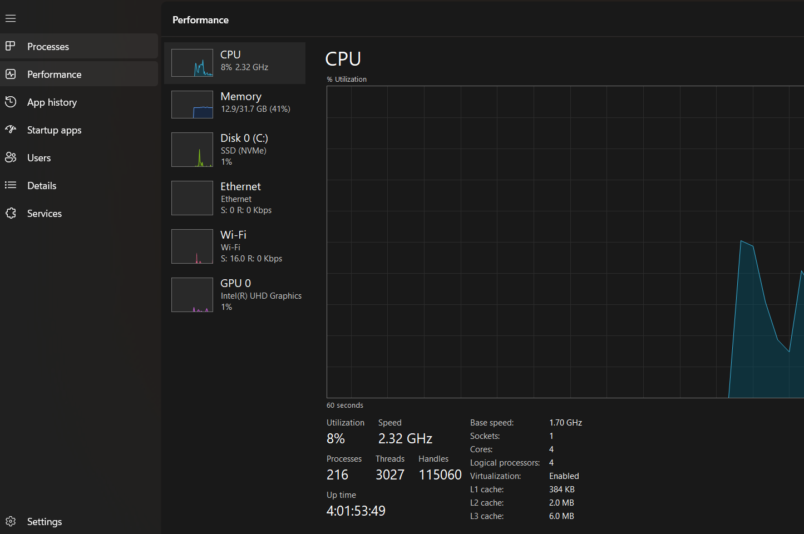
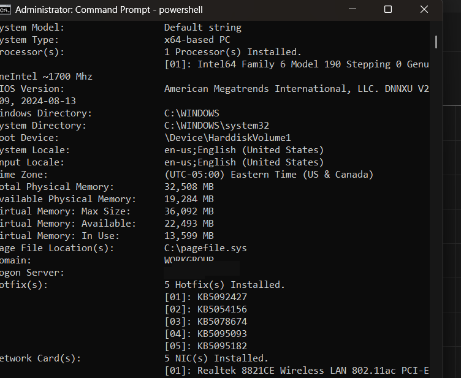
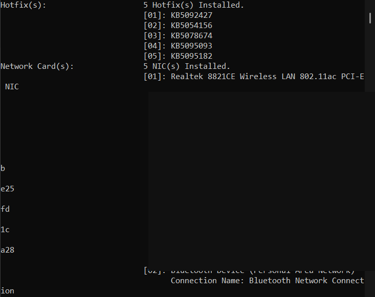
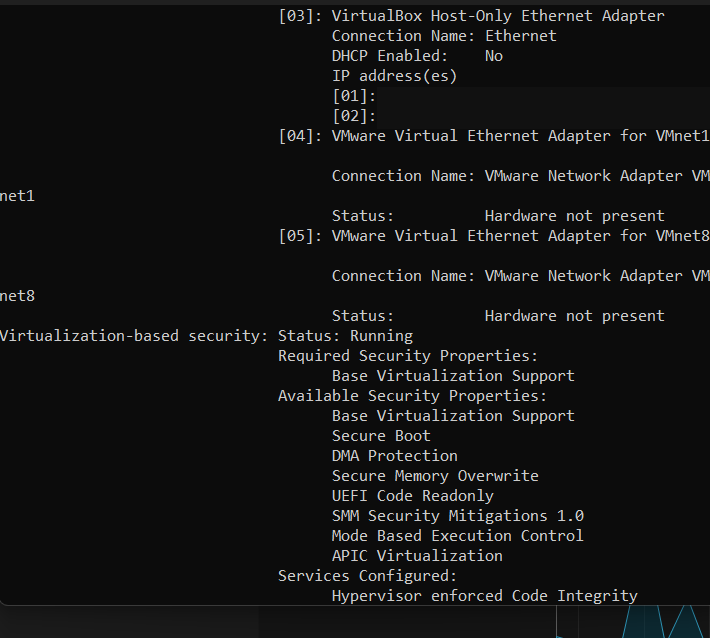
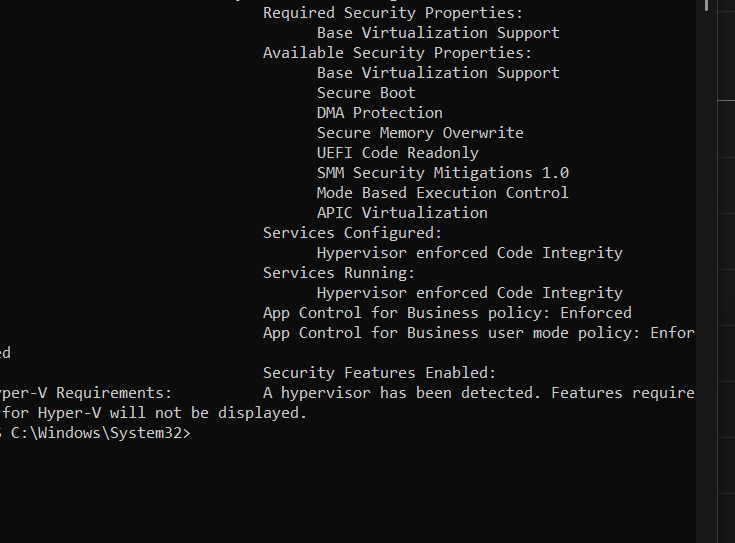
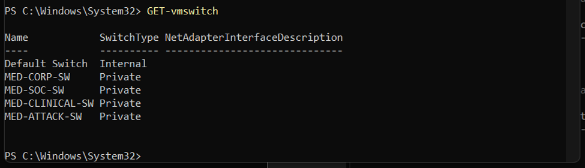
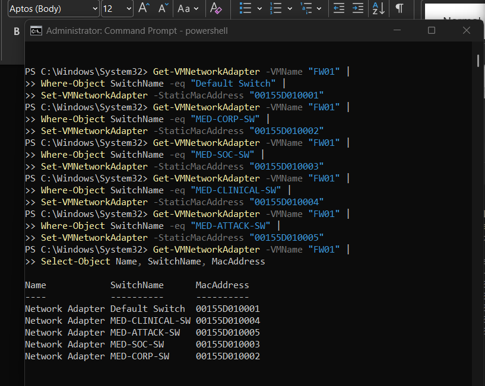
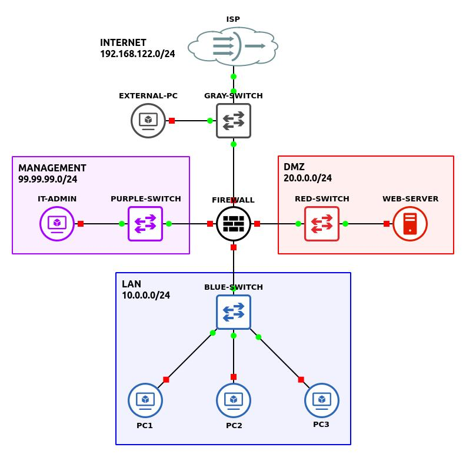

# Architecture and Asset Inventory

## Host baseline
- Host label: GHOST
- Operating system: Windows 10 Pro (64-bit; build observed as 10.0.26200)
- Processor: Intel N95; 4 cores / 4 logical processors
- RAM: ~32 GB
- Storage: NVMe SSD, ~560 GB free on C: at initial assessment
- Firmware virtualization: Enabled in Task Manager
- Windows virtualization-based security: Running
- Hyper-V chosen as project hypervisor; VirtualBox also installed on host

## Host baseline evidence

### S01 — Host hardware baseline

Captured implementation evidence: host hardware baseline.

### S02 — Host storage capacity

Captured implementation evidence: host storage capacity.

### S03 — Firmware virtualization enabled

Captured implementation evidence: firmware virtualization enabled.

### S04 — Host system information

Captured implementation evidence: host system information.

### S05 — Host network inventory redacted

Captured implementation evidence: host network inventory redacted.

### S06 — Virtual adapter and vbs state

Captured implementation evidence: virtual adapter and vbs state.

### S07 — Hypervisor security state

Captured implementation evidence: hypervisor security state.

## FW01 virtual firewall
- Hypervisor: Hyper-V
- Guest: pfSense CE 2.8.1 (FreeBSD amd64)
- Generation: 2; Secure Boot disabled for installation
- Provisioned resources observed: 2 vCPU, 2 GB RAM, 20 GB VHDX
- Disk: GPT, ZFS single-disk stripe (no redundancy)
- ISO installation media should be detached after successful installation.

## Network interface map (verified via PowerShell and installer)
| Purpose | Hyper-V switch | Guest NIC | Static MAC |
|---|---|---|---|
| WAN | Default Switch | hn0 | 00:15:5d:01:00:01 |
| CORP | MED-CORP-SW | hn4 | 00:15:5d:01:00:02 |
| SOC | MED-SOC-SW | hn3 | 00:15:5d:01:00:03 |
| CLINICAL | MED-CLINICAL-SW | hn1 | 00:15:5d:01:00:04 |
| ATTACK | MED-ATTACK-SW | hn2 | 00:15:5d:01:00:05 |

**Important:** Guest interface numbering did not match intended zone order. MAC correlation is authoritative.

## Network mapping evidence

### S10 — Private zone switches

Captured implementation evidence: private zone switches.

### S16 — Static mac zone verification

Captured implementation evidence: static mac zone verification.

## IP plan
- WAN: DHCP on Hyper-V Default Switch; observed 172.21.139.31/20 (lease may change).
- CORP: 10.10.10.0/24, gateway 10.10.10.1; installer DHCP range intended 10.10.10.100–10.10.10.199 (verify after boot).
- SOC: 10.10.20.0/24, configured gateway 10.10.20.1.
- CLINICAL: 10.10.30.0/24, configured gateway 10.10.30.1.
- ATTACK: 10.10.40.0/24, configured gateway 10.10.40.1.

## Isolation and management considerations
The CORP/SOC/CLINICAL/ATTACK virtual switches are **Private**. The Windows host cannot directly communicate with guests on these switches without an additional host-facing network path or management VM. Do not expose the pfSense management GUI to WAN. Plan an admin VM attached to CORP or a deliberately controlled management segment.

## Planned firewall policy
- ATTACK to other internal zones: block by default.
- CORP and CLINICAL: permit only justified application and identity flows.
- SOC management access: narrowly scoped and logged.
- All outbound access: explicit egress policy, logging, and test cases.

All four internal gateway addresses are console-verified; firewall policies and inter-zone connectivity remain untested.

## Planning reference

### S11 — Reference topology not implemented

Reference diagram shared during planning. Its DMZ/management subnets are not the implemented MedSecure architecture; source provenance was not supplied.

## CORP management workstation — Ubuntu installed and desktop boot verified

| Asset | Operating system | Network | Status |
|---|---|---|---|
| MED-UBUNTU-01 (renamed from CORP-WS01) | Ubuntu Desktop 24.04.5 LTS (AMD64) | MED-CORP-SW; CORP 10.10.10.0/24 | Installation complete; login and desktop verified; 4096 MB RAM, 2 vCPU; guest hostname/IP not yet checked |

Ubuntu replaces the Windows management client in the architecture map to provide a free desktop for pfSense administration and Linux practice. Installation ISO detached from virtual DVD drive (None selected). Browser access to the CORP pfSense gateway at 10.10.10.1 remains unverified. See [Ubuntu deployment journal](10-ubuntu-endpoint-deployment.md). Windows Server AD/DNS and Windows endpoints remain future enterprise workloads; this decision applies to the management workstation.
