# Build Journal — Phase 1

## 1. Host discovery
Collected PowerShell Get-ComputerInfo, Get-CimInstance Win32_Processor, and Get-Volume outputs. Confirmed Intel N95 (4C/4T), approximately 32 GB RAM, NVMe disk capacity, and Windows virtualization state. Initial virtualization-firmware reporting was inconsistent with Task Manager; later Task Manager confirmed firmware virtualization enabled. systeminfo reported a hypervisor detected and virtualization-based security running.

## 2. Hypervisor selection
Evaluated VMware/VirtualBox coexistence with Windows virtualization features. Chose Microsoft Hyper-V as the primary lab hypervisor. Verified Hyper-V management cmdlets and initial Default Switch. Created four private switches: MED-CORP-SW, MED-SOC-SW, MED-CLINICAL-SW, MED-ATTACK-SW.

### S08 — Hyper v feature diagnostic

Initial diagnostic: Hyper-V feature disabled and Get-VMSwitch unavailable. Later switch output records successful setup.

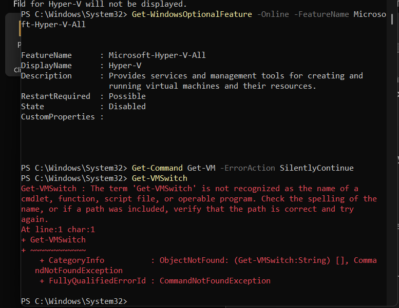

### S09 — Hyper v initial switch

Captured implementation evidence: hyper v initial switch.

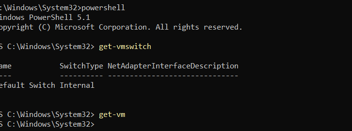

## 3. Firewall provisioning
Created Generation 2 VM FW01, disabled Secure Boot for the installer, attached a 20 GB virtual disk and installation ISO, and added five network adapters (Default Switch + four private switches). Verified with Get-VMNetworkAdapter.

### S12 — Netgate installer media selection

Installer media choices shown for evaluation; the menu highlight alone does not prove the downloaded image type.

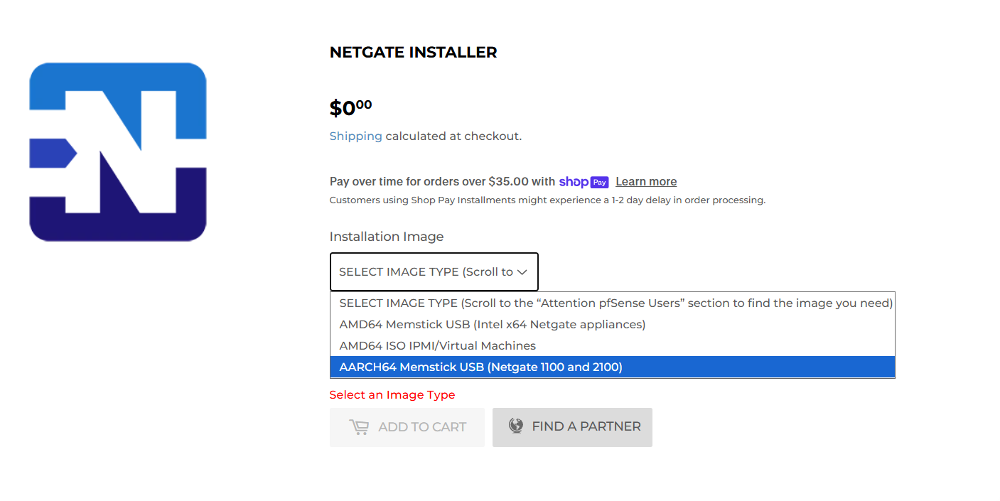

### S13 — Fw01 secure boot settings

Captured implementation evidence: fw01 secure boot settings.

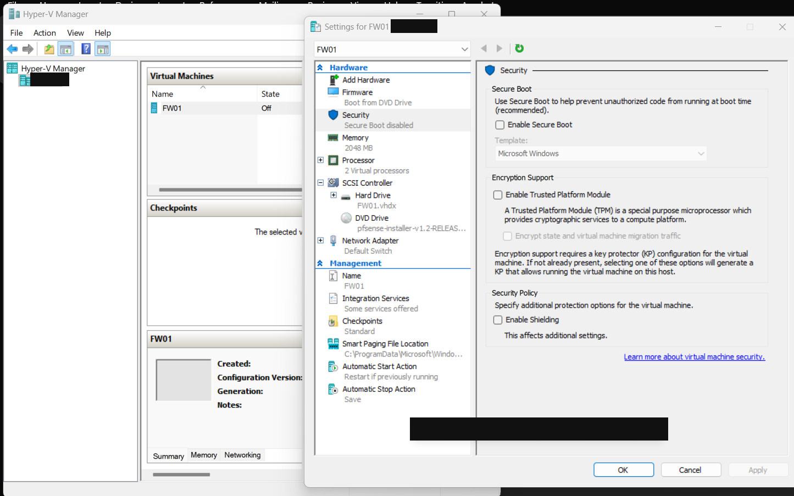

### S14 — Fw01 five network adapters

Captured implementation evidence: fw01 five network adapters.

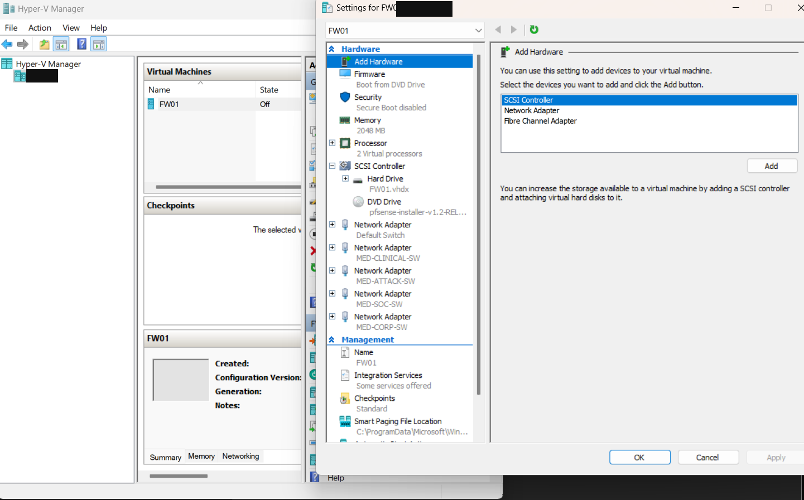

### S15 — Initial adapter mac state

Initial adapters show zero MAC values before static assignment.

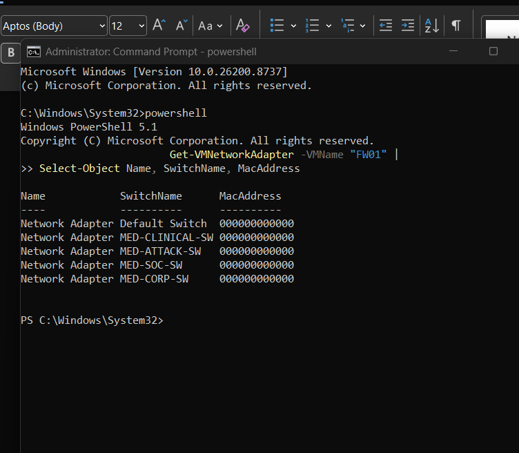

## 4. Stable MAC-to-zone identification
Used Set-VMNetworkAdapter -StaticMacAddress, selecting each adapter by SwitchName. Assigned ...01 WAN, ...02 CORP, ...03 SOC, ...04 CLINICAL, ...05 ATTACK. Re-ran Get-VMNetworkAdapter and verified all five assignments.

## 5. Installer media troubleshooting
First startup failed with Synthetic SCSI Controller/DVD attachment error: 'The file or directory is corrupted and unreadable'. The ISO path was inside iCloud Drive. Recommended copying/re-downloading to local C:\Hyper-V\ISO, validating readability, and reattaching. A subsequent screenshot confirmed successful installer boot. The exact corrective action taken was not independently recorded; do not claim a hash comparison was completed.

### S17 — Iso attachment error redacted

Captured implementation evidence: iso attachment error redacted.

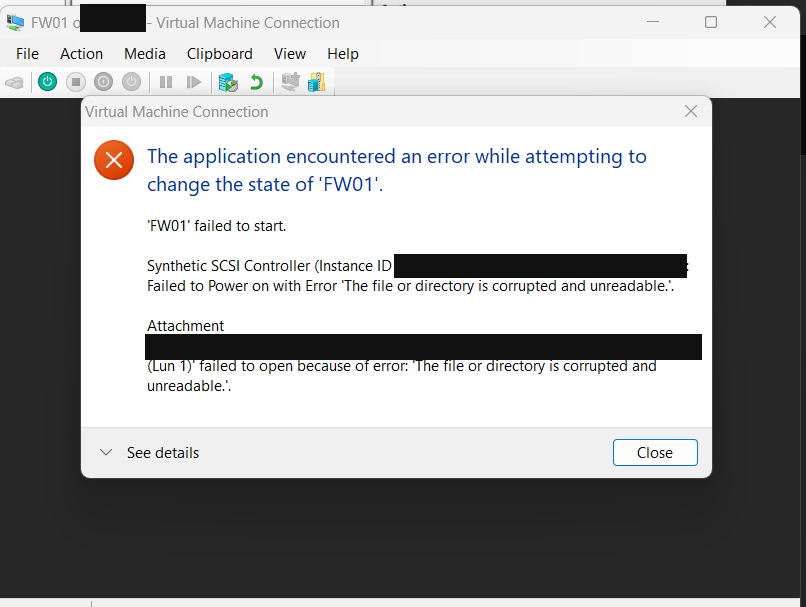

## 6. pfSense installation
- Booted Netgate Installer v1.2.
- Selected WAN hn0 by MAC ...01; DHCP client, VLAN tagging off, local resolver off.
- Selected LAN hn4 by MAC ...02; planned static 10.10.10.1/24 and DHCP range 10.10.10.100–199.
- Confirmed WAN/LAN assignments.
- Selected pfSense CE (no Plus subscription).
- Selected ZFS, GPT, single-disk stripe.
- Confirmed selected da0 20G Microsoft Virtual Disk and approved overwrite.
- Selected pfSense CE 2.8.1.

### S18 — Netgate installer start

Captured implementation evidence: netgate installer start.

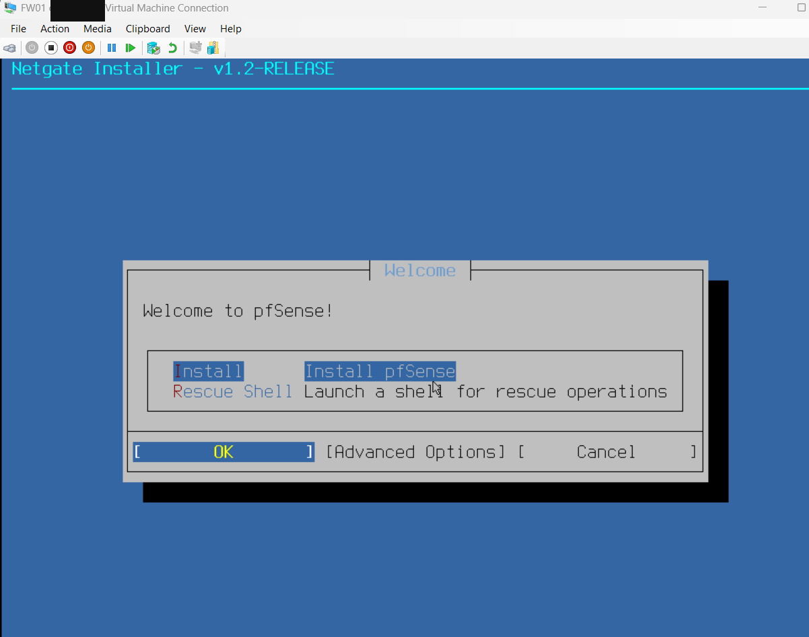

### S19 — Wan interface selection

Captured implementation evidence: wan interface selection.

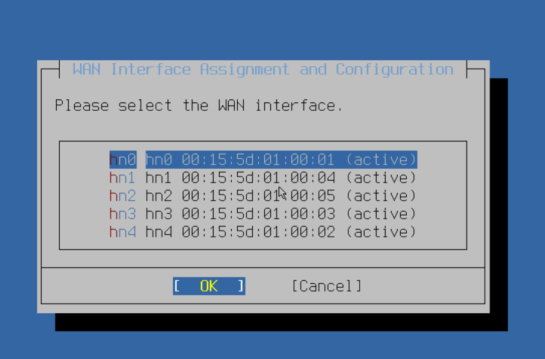

### S20 — Wan dhcp mode

Captured implementation evidence: wan dhcp mode.

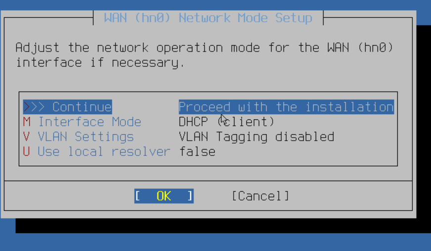

### S21 — Lan interface selection

LAN selection menu before confirmation; hn4 is confirmed in S23.

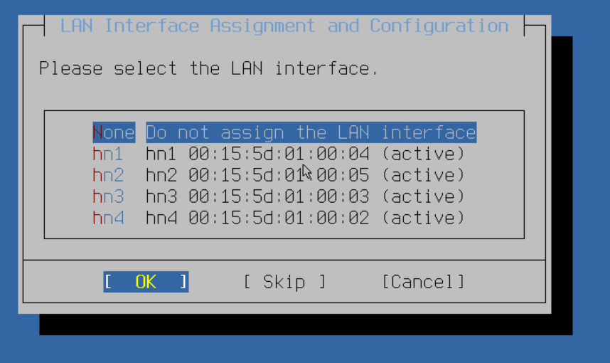

### S22 — Lan default settings before change

Installer defaults: 192.168.1.1/24 and 192.168.1.100–199. Final console S30 shows 10.10.10.1/24. No screenshot verifies the final DHCP range.

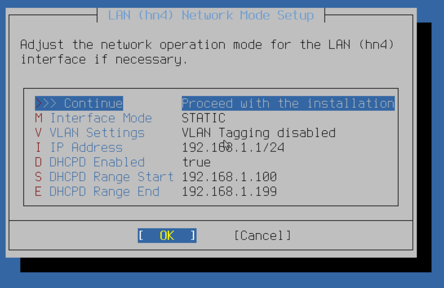

### S23 — Wan lan assignment confirmation

Captured implementation evidence: wan lan assignment confirmation.

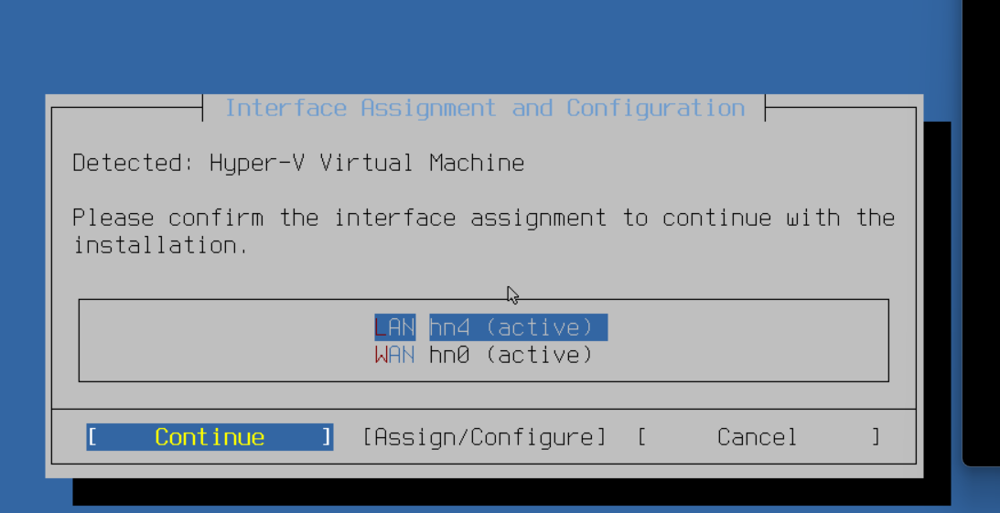

### S24 — Community edition selection

Captured implementation evidence: community edition selection.

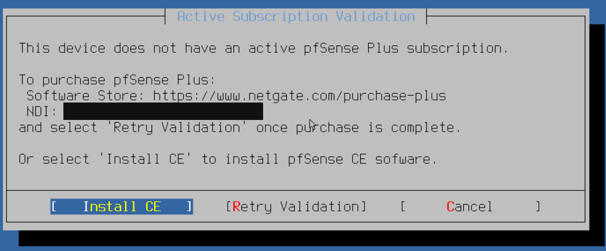

### S25 — Zfs gpt installation options

Captured implementation evidence: zfs gpt installation options.

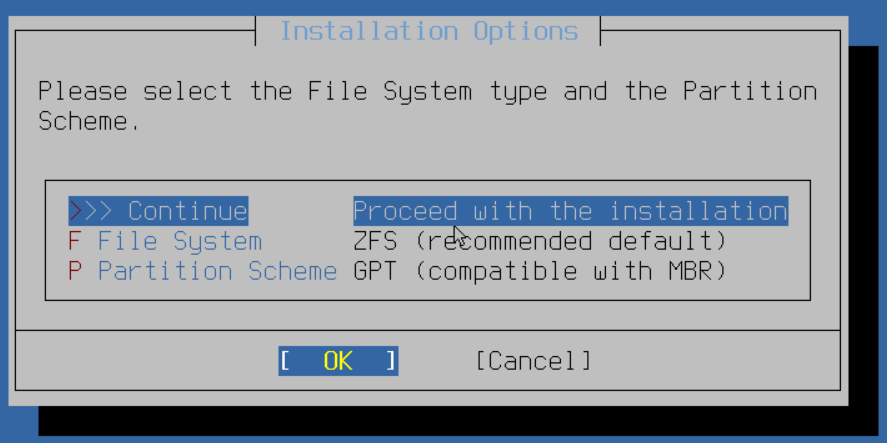

### S26 — Zfs stripe no redundancy

Captured implementation evidence: zfs stripe no redundancy.

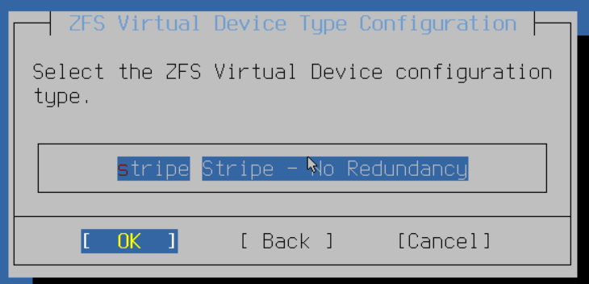

### S27 — Virtual disk selection

Captured implementation evidence: virtual disk selection.

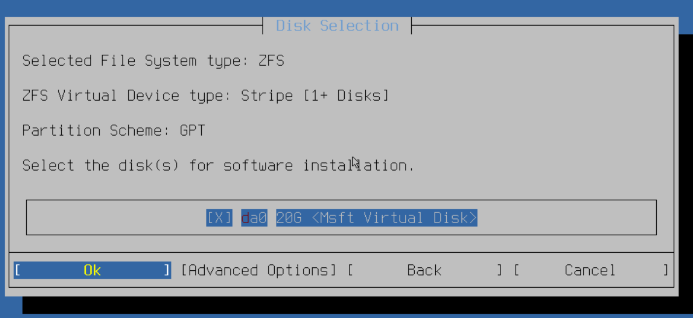

### S28 — Virtual disk overwrite confirmation

Captured implementation evidence: virtual disk overwrite confirmation.

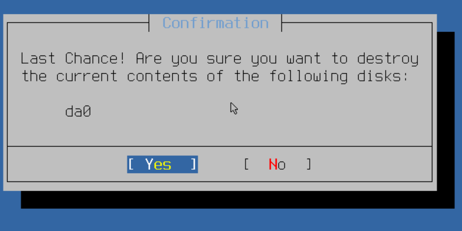

### S29 — Pfsense version selection

Captured implementation evidence: pfsense version selection.

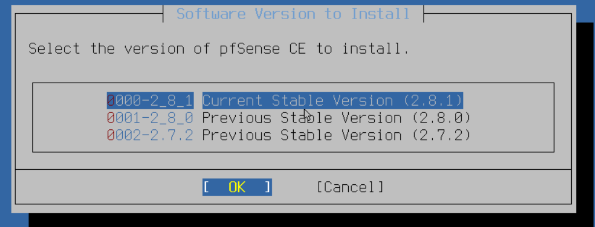

## 7. Initial boot validation
Console displayed 'Bootup complete', pfSense 2.8.1-RELEASE amd64, WAN hn0 with DHCP 172.21.139.31/20, and LAN hn4 with 10.10.10.1/24. This verifies installation and initial two-interface addressing; it does **not** yet verify outbound internet reachability, DHCP client leasing on CORP, or remaining zone interfaces.

### S30 — Pfsense initial boot verification

Bootup complete; pfSense CE 2.8.1, WAN DHCP and CORP LAN 10.10.10.1/24. Connectivity and additional zones still require testing.

## 8. Pending baseline
Detach ISO; reboot from VHDX; verify WAN DNS/internet and CORP DHCP; export configuration and create a rollback point. Assign remaining interfaces and validate policy.

## Evidence
See [Evidence register](04-evidence-register.md). All 30 retrieved build screenshots are published as sanitized PNGs. See the [troubleshooting record](06-troubleshooting.md) and [verification matrix](07-verification.md).

## Evidence clarification
S22 records installer defaults, not the final CORP DHCP configuration. The earlier intended DHCP range remains unverified. S30 proves the final CORP gateway only.

## Project documentation summary
I assessed my host, built four private Hyper-V switches, provisioned FW01 with five adapters, assigned deterministic lab MAC addresses, and installed pfSense CE 2.8.1. I recorded the installer-media failure and preserved sanitized evidence of the successful boot. I distinguished observed results from remaining segmentation, DHCP, connectivity, and recovery checks.
