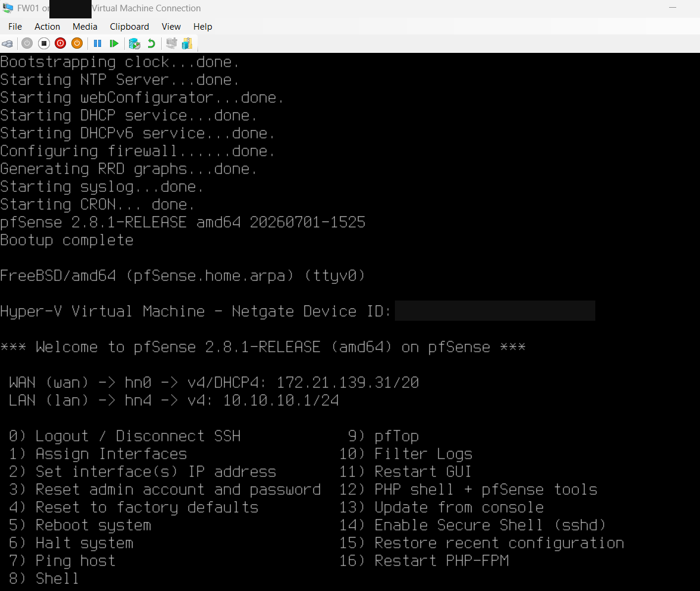

# Verification Evidence

## Lab verification matrix

| Control or milestone | Status | Evidence / limitation |
|---|---|---|
| Firmware virtualization | Observed enabled | Task Manager S03; initial command output differed. |
| Four Private zone switches | Verified in inventory | S10 shows CORP, SOC, CLINICAL and ATTACK. |
| Five FW01 adapters / static mapping | Verified in inventory | S14 and S16; guest selection S19 confirms interface order. |
| pfSense CE 2.8.1 installed and booted | Verified | S30 displays version and Bootup complete. |
| WAN DHCP / CORP gateway | Verified in console | S30: WAN hn0 DHCP; LAN hn4 10.10.10.1/24. |
| CORP client DHCP / internet / DNS | Pending | No client lease or reachability test supplied. |
| SOC, CLINICAL, ATTACK gateways and isolation | Pending | No policy or traffic-test evidence supplied. |
| Backup, restore and ISO-detached reboot | Pending | No recovery evidence supplied. |

## Initial boot evidence

### S30 — Pfsense initial boot verification

Bootup complete; pfSense CE 2.8.1, WAN DHCP and CORP LAN 10.10.10.1/24. Connectivity and additional zones still require testing.

## Publication checks
All 30 sanitized PNGs were decoded locally and all relative image paths checked before publication. Post-publication checks on 2026-10-11 confirmed that all 30 committed PNGs match the sanitized local files byte for byte and decode successfully. GitHub's rendered architecture page loaded 10 evidence images, and its build journal loaded the remaining 20; every image reported complete loading and a nonzero natural width. The README milestone image also loaded correctly. All six original documentation files remain present. GitHub rendering checks concern portfolio integrity, not lab connectivity.

## Next evidence to collect
Record interface assignments, DHCP client leases, allowed and blocked traffic tests, DNS/egress checks, configuration backup and restore validation. Add new screenshots to their implementation phase only after privacy review.
