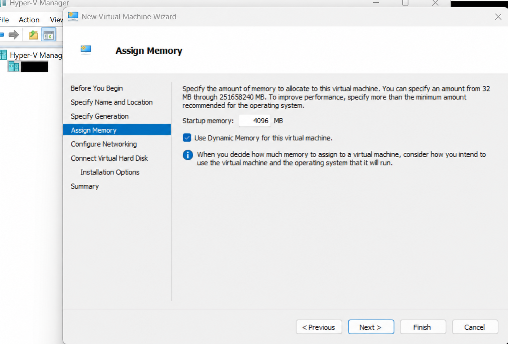
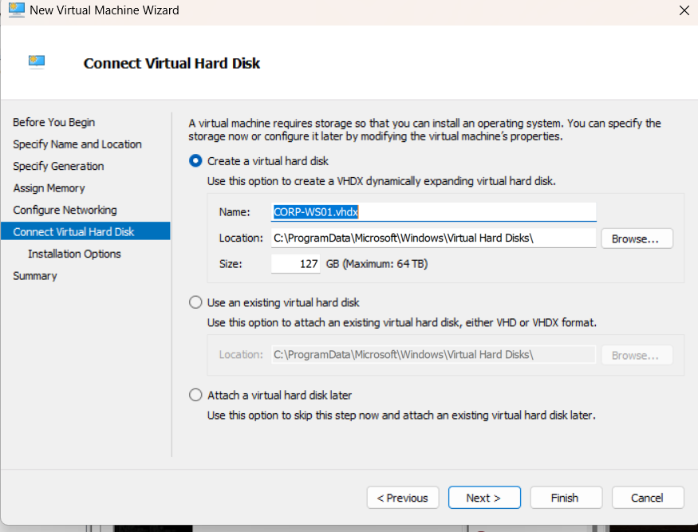
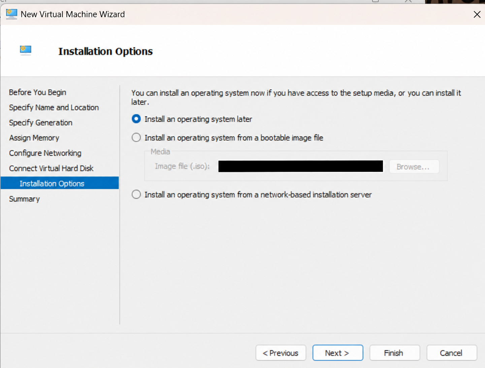
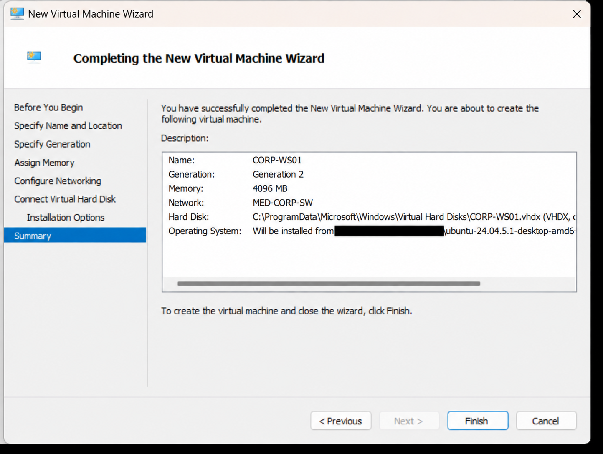
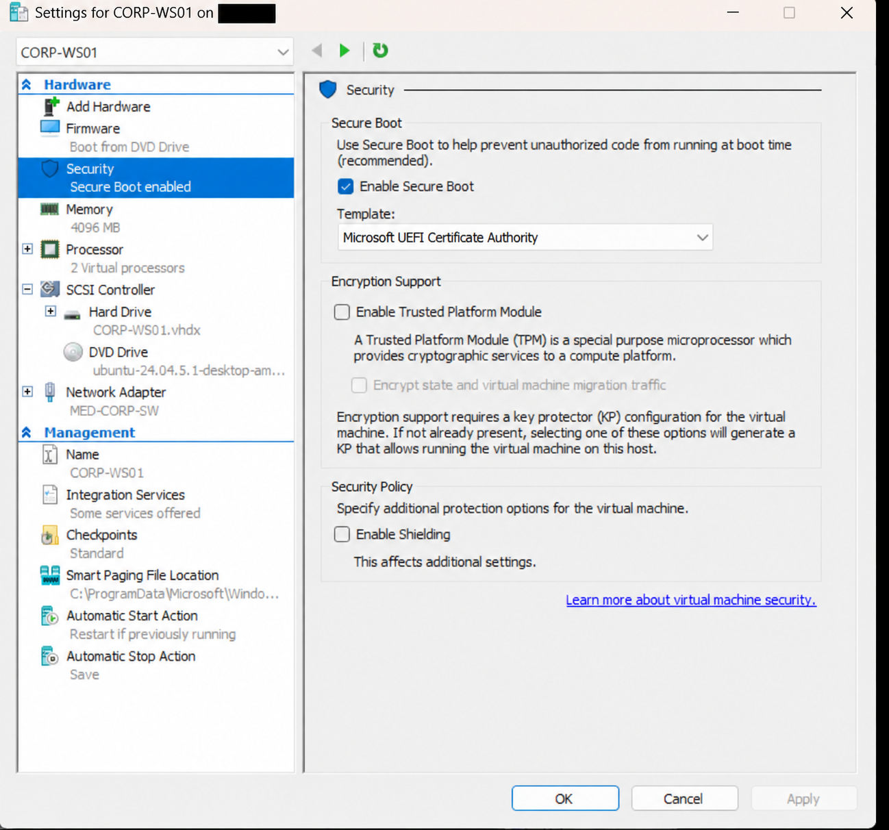
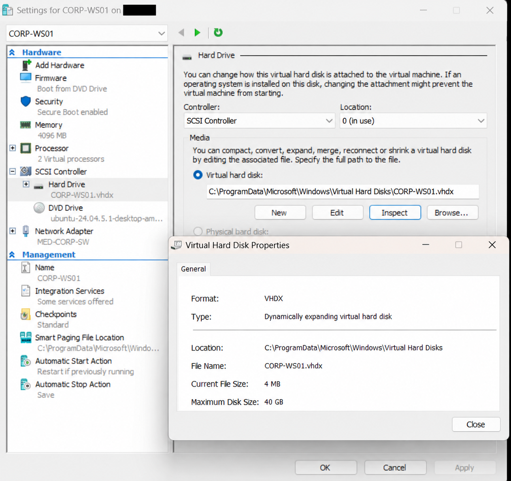

# Phase 2 — Network Segmentation

**Status:** All five interface assignments are applied and verified at the console. SOC/OPT1 IPv4 configuration is saved at 10.10.20.1/24; CLINICAL/OPT2 is saved at 10.10.30.1/24; ATTACK/OPT3 is saved at 10.10.40.1/24. Addressing is complete. Ubuntu Desktop 24.04.5 LTS is installed on **MED-UBUNTU-01** (formerly CORP-WS01), with ISO detachment, login and desktop verified. Guest networking, management access and segmentation tests remain pending.

**Naming note:** Checkpoints 11–17 retain CORP-WS01 and CORP-WS01.vhdx as shown in the original setup screenshots. The current Hyper-V VM name is MED-UBUNTU-01; a VHDX filename change and Linux guest hostname change have not been verified. Pending statements in those checkpoints describe their historical stage; see Checkpoint 18 for the current state.

## Checkpoint 1 — Baseline review
The supplied Hyper-V view shows FW01 off and a checkpoint named `FW01 - pfSense 2.8.1 Clean Install`. This confirms a checkpoint entry exists, not that restore has been tested. The next console screenshot shows pfSense CE 2.8.1 completing startup, WAN hn0 receiving 172.28.254.188/20 by DHCP, and CORP/LAN hn4 retaining 10.10.10.1/24. ISO removal was instructed but is not directly proved by these screenshots.

## Checkpoint 2 — Interface inventory before assignment
I opened console option 1 (Assign Interfaces), reviewed the five detected Hyper-V NICs, and selected `n` for VLAN setup. The screenshot is paused at the WAN interface-name prompt; assignment has not been committed.

| Role | Guest NIC | Deliberate lab MAC | Observed link state | Assignment status |
|---|---|---|---|---|
| WAN | hn0 | 00:15:5d:01:00:01 | up | Existing; preserve |
| CORP / LAN | hn4 | 00:15:5d:01:00:02 | up | Existing; preserve |
| SOC / OPT1 | hn3 | 00:15:5d:01:00:03 | down | Planned |
| CLINICAL / OPT2 | hn1 | 00:15:5d:01:00:04 | down | Planned |
| ATTACK / OPT3 | hn2 | 00:15:5d:01:00:05 | down | Planned |

The NICs are detected even where link state is down. Peer VM connectivity and Hyper-V switch attachments must be checked before interpreting this as a fault. MAC correlation preserves the mapping despite guest enumeration order.

## Checkpoint 3 — Assignment summary reviewed
I entered WAN hn0, LAN hn4, OPT1 hn3, OPT2 hn1 and OPT3 hn2. The proposed assignment summary matches the five-zone plan. The corrected screenshot is paused at the proceed prompt with a blank input field; this is not evidence that the configuration has been applied. The earlier screenshot was superseded at the same evidence path to avoid duplicate publication.

## Checkpoint 4 — Applied assignments verified
After confirming the assignment, I returned to the console menu. The resulting interface list verifies WAN hn0, LAN hn4, OPT1 hn3, OPT2 hn1 and OPT3 hn2. WAN retains DHCP address 172.28.254.188/20 and LAN retains 10.10.10.1/24. OPT1, OPT2 and OPT3 have no displayed IP addresses yet. This verifies interface assignment, not client connectivity or firewall-policy enforcement.

## Checkpoint 5 — SOC interface selection
I opened console option 2 and verified the displayed interface numbers: WAN/hn0 is 1, LAN/hn4 is 2, OPT1/hn3 is 3, OPT2/hn1 is 4 and OPT3/hn2 is 5. The screenshot is paused before selecting an interface. No SOC IP address has been entered or verified yet.

## Checkpoint 6 — SOC static IPv4 values entered
I selected interface 3 (OPT1/hn3), declined DHCP for its IPv4 address, entered 10.10.20.1 with prefix 24, and left the upstream gateway blank because SOC is an internal network. The console is paused at the DHCP6 question. These are entered values; completion and applied addressing still require subsequent evidence.

## Checkpoint 7 — SOC IPv4 configuration saved
I declined DHCP6, left the IPv6 address blank, disabled DHCP service on OPT1 and retained HTTPS. pfSense reloaded the filter and routing configuration, then explicitly confirmed that OPT1 was set to 10.10.20.1/24. This verifies the saved interface address; no client connectivity, webConfigurator reachability or segmentation-policy tests have been performed.

## Checkpoint 8 — CLINICAL IPv4 configuration saved
I configured OPT2/hn1 for the CLINICAL network. The console confirms 10.10.30.1/24 was saved after filter and routing reloads. The screenshot shows no upstream gateway, no IPv6 address, DHCP service disabled and HTTPS retained. The displayed webConfigurator URL is configuration output, not evidence of successful browser access or client connectivity.

## Checkpoint 9 — ATTACK IPv4 configuration saved
The console explicitly confirms OPT3 was set to 10.10.40.1/24 after configuration reloads. This completes the planned internal gateway addressing: CORP 10.10.10.1/24, SOC 10.10.20.1/24, CLINICAL 10.10.30.1/24 and ATTACK 10.10.40.1/24. This cropped confirmation does not show the DHCP or IPv6 answers; those settings are not independently verified here. The displayed HTTPS URL is not proof of successful web access.

## Checkpoint 10 — Consolidated interface and address verification
I returned to the console menu and verified all five mappings and their current IPv4 addresses together.

| Role | Interface | Verified IPv4 |
|---|---|---|
| WAN | hn0 | DHCP 172.28.254.188/20 |
| CORP / LAN | hn4 | 10.10.10.1/24 |
| SOC / OPT1 | hn3 | 10.10.20.1/24 |
| CLINICAL / OPT2 | hn1 | 10.10.30.1/24 |
| ATTACK / OPT3 | hn2 | 10.10.40.1/24 |

## Next procedure — CORP management access
The management client is now installed as **MED-UBUNTU-01** on MED-CORP-SW. Verify its Linux guest hostname, IP address and route, then test the CORP gateway and https://10.10.10.1/. Internal switches remain Private; browser access and policy enforcement remain unverified.

## Checkpoint 11 — Management operating system selected (2026-10-11)
I selected Ubuntu Desktop 24.04 LTS as the free operating system for CORP-WS01, replacing the Windows management-client plan. I confirmed the ISO download in conversation. The exact ISO filename, checksum, VM creation, installation and browser access have not yet been verified. The architecture map and asset plan reflect this selection; no download screenshot was supplied.

## Checkpoint 12 — Management VM memory wizard
I reached Assign Memory in the New Virtual Machine Wizard. The screen shows 4096 MB startup memory with Dynamic Memory enabled. These are wizard selections, not proof of a completed VM. The name, generation, network and disk will be verified in the summary or final settings.

The published image is a privacy-edited copy with the host label masked and output dimensions changed by the image editor. The visible 4096 MB value and checked Dynamic Memory were compared with the supplied original. It is stored in lossless WebP format.

## Checkpoint 13 — Virtual disk selection
I reached Connect Virtual Hard Disk. The selected option creates a dynamically expanding VHDX named CORP-WS01.vhdx in Hyper-V's default virtual-disk folder. The screenshot shows the default maximum capacity of 127 GB; this is a wizard value, not a completed disk. I distinguished the VHDX (the guest's persistent operating-system and data storage) from the Ubuntu ISO (installation media attached to the virtual DVD drive).

The next instruction is to set the disk maximum to 40 GB, then attach the downloaded Ubuntu ISO under Installation Options. The 40 GB value and ISO attachment remain pending verification.

Privacy review: this screenshot contains a lab VM filename and a generic Windows system folder, with no visible personal account, secret or sensitive identifier. No redaction was needed.

## Checkpoint 14 — Installation media selection pending
I reached Installation Options. The screenshot shows Install an operating system later selected, with the bootable-image option unselected. The disabled image field contains a folder path rather than an ISO filename. This does not verify ISO attachment.

The next step is to select Install an operating system from a bootable image file, browse to the downloaded Ubuntu desktop ISO, then review the wizard summary before creating the VM.

Privacy review: the personal folder path was masked. The image editor changed output dimensions; visible option selections and UI labels were compared with the original. The published copy uses lossless WebP encoding.

## Checkpoint 15 — CORP management workstation summary reviewed
I reviewed the pre-creation summary: CORP-WS01, Generation 2, 4096 MB memory and MED-CORP-SW. The disk is CORP-WS01.vhdx. Installation from Ubuntu desktop AMD64 media is selected; the visible filename begins ubuntu-24.04.5.1-desktop-amd6 and is truncated. The complete filename and checksum remain unverified. The summary is paused before Finish, so it does not prove VM creation or Ubuntu installation. Disk capacity is outside the visible area and the intended 40 GB remains unverified.

Privacy review: the personal directory prefix and unrelated background are masked. The image editor changed output dimensions; name, generation, memory, network and visible filename were compared with the original. The copy uses lossless WebP encoding.

Next steps: finish creation, keep Secure Boot enabled with the Microsoft UEFI Certificate Authority template, set two virtual processors, verify disk capacity, and boot the ISO. These settings and boot remain pending evidence.

## Checkpoint 16 — Created VM and pre-boot settings verified
I opened Settings for the created CORP-WS01 VM. Secure Boot is enabled with Microsoft UEFI Certificate Authority selected. The settings navigation shows 4096 MB memory, two virtual processors, CORP-WS01.vhdx, Ubuntu desktop media attached to DVD Drive and MED-CORP-SW attached to the Network Adapter. Firmware lists Boot from DVD Drive. Apply is disabled, consistent with no pending edits in this view. TPM and Shielding are unchecked.

Privacy review: host label and unrelated background were masked. The editor changed dimensions; the key settings were visually compared with the original. Published in lossless WebP. VM creation is now evidenced; disk capacity, successful ISO boot, Ubuntu installation and pfSense browser access remain unverified.

## Checkpoint 17 — Virtual disk capacity verified
I inspected CORP-WS01.vhdx. Virtual Hard Disk Properties confirms VHDX format, a dynamically expanding disk, current file size 4 MB and maximum disk size 40 GB. This verifies the intended capacity without allocating the full maximum immediately. The attached disk is on SCSI Controller location 0. Ubuntu boot and installation remain pending.

Privacy review: host label and unrelated background are masked. The image editor changed output dimensions; the disk filename, type and capacities were compared with the original. Stored as lossless WebP.

Next: close disk properties and Settings, connect to CORP-WS01, start the VM and select Try or Install Ubuntu at the boot menu.

## Checkpoint 18 — Ubuntu installed, VM renamed and desktop verified (2026-10-11)

I completed Ubuntu Desktop 24.04.5 LTS installation, set the virtual DVD Drive to None, renamed the Hyper-V VM **MED-UBUNTU-01**, and verified the login screen and Ubuntu desktop. The endpoint has 4096 MB RAM, 2 vCPU and a 40 GB dynamically expanding VHDX on MED-CORP-SW. The VM display name is verified; the guest hostname and network configuration remain to be checked.

See the [Ubuntu deployment journal and nine screenshots P2-18–P2-26](10-ubuntu-endpoint-deployment.md#published-screenshot-evidence). Earlier setup screenshots retain the original CORP-WS01 name and disk filename as historical evidence.

## Remaining validation
- Establish a controlled management path; verify client DHCP, DNS and approved egress.
- Test allowed and denied inter-zone flows; export a configuration backup and validate recovery.

## Publication and privacy
The first eleven screenshots document firewall addressing; P2-12 through P2-17 document management-workstation wizard selections. These seventeen screenshots have been reviewed for privacy. Nine additional Ubuntu installation and boot screenshots are published in the linked Ubuntu deployment journal, bringing Phase 2 to 26 screenshots. The first three have host labels and the Netgate device identifier masked; P2-04 through P2-11 contain no visible personal information or sensitive identifiers and required no redaction. Deliberately assigned lab MACs and private lab addressing remain for reproducibility. Each screenshot appears once in this journal; other documentation links here rather than duplicating images.

## Project documentation summary
I reviewed my clean-install checkpoint, verified pfSense startup and the existing WAN/CORP addressing, and correlated all five guest interfaces with the static lab MAC plan. I declined VLAN setup because the planned zones use separate virtual adapters. I entered the five interface names and reviewed the proposed summary against the zone plan. I subsequently verified all five applied assignments at the console, with WAN and CORP addressing preserved. I configured and saved SOC/OPT1 at 10.10.20.1/24 with DHCP disabled and HTTPS retained. I also saved CLINICAL/OPT2 at 10.10.30.1/24 with DHCP disabled and HTTPS retained. I verified the ATTACK/OPT3 save confirmation at 10.10.40.1/24, completing the internal address plan. I also installed Ubuntu Desktop 24.04.5 LTS, renamed the Hyper-V management VM MED-UBUNTU-01, detached its installer ISO and verified login and desktop boot. Guest hostname/network checks, management access and segmentation enforcement remain untested.
