# Phase 2 — Network Segmentation

**Status:** All five interface assignments are applied and verified at the console. SOC/OPT1 IPv4 configuration is saved at 10.10.20.1/24; CLINICAL/OPT2 is saved at 10.10.30.1/24; ATTACK/OPT3 is saved at 10.10.40.1/24. Addressing is complete; management access and segmentation tests remain pending.

## Checkpoint 1 — Baseline review
The supplied Hyper-V view shows FW01 off and a checkpoint named `FW01 - pfSense 2.8.1 Clean Install`. This confirms a checkpoint entry exists, not that restore has been tested. The next console screenshot shows pfSense CE 2.8.1 completing startup, WAN hn0 receiving 172.28.254.188/20 by DHCP, and CORP/LAN hn4 retaining 10.10.10.1/24. ISO removal was instructed but is not directly proved by these screenshots.

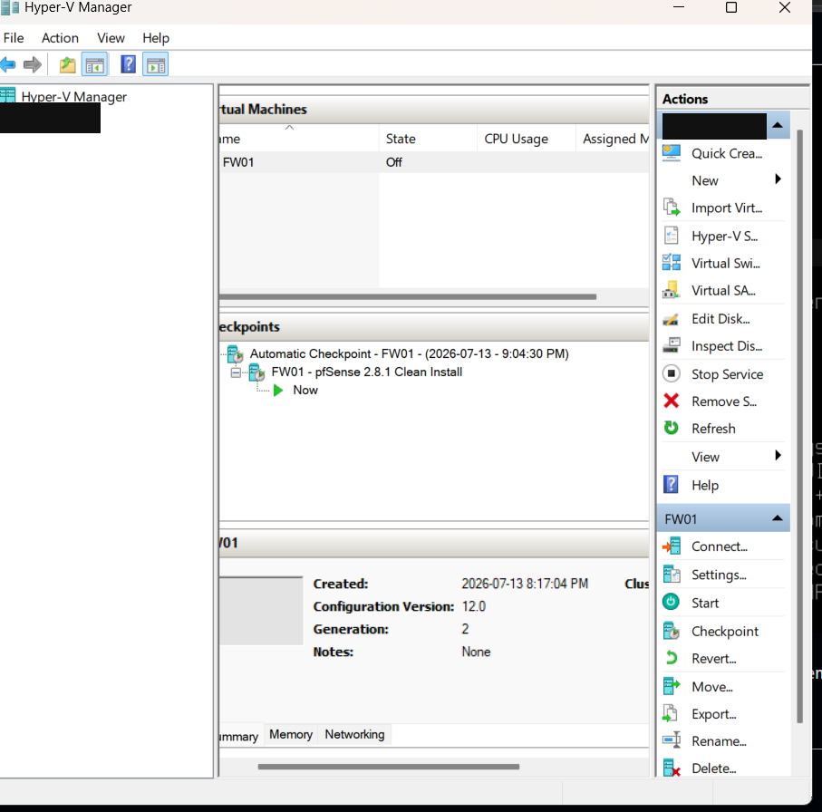

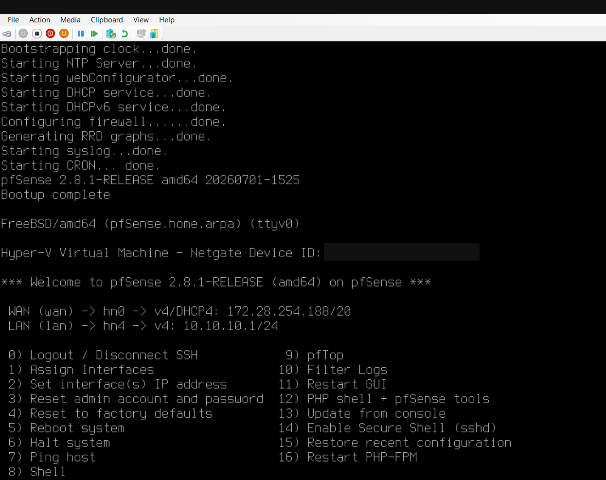

## Checkpoint 2 — Interface inventory before assignment
I opened console option 1 (Assign Interfaces), reviewed the five detected Hyper-V NICs, and selected `n` for VLAN setup. The screenshot is paused at the WAN interface-name prompt; assignment has not been committed.

| Role | Guest NIC | Deliberate lab MAC | Observed link state | Assignment status |
|---|---|---|---|---|
| WAN | hn0 | 00:15:5d:01:00:01 | up | Existing; preserve |
| CORP / LAN | hn4 | 00:15:5d:01:00:02 | up | Existing; preserve |
| SOC / OPT1 | hn3 | 00:15:5d:01:00:03 | down | Planned |
| CLINICAL / OPT2 | hn1 | 00:15:5d:01:00:04 | down | Planned |
| ATTACK / OPT3 | hn2 | 00:15:5d:01:00:05 | down | Planned |

The NICs are detected even where link state is down. Peer VM connectivity and Hyper-V switch attachments must be checked before interpreting this as a fault. MAC correlation preserves the mapping despite guest enumeration order.

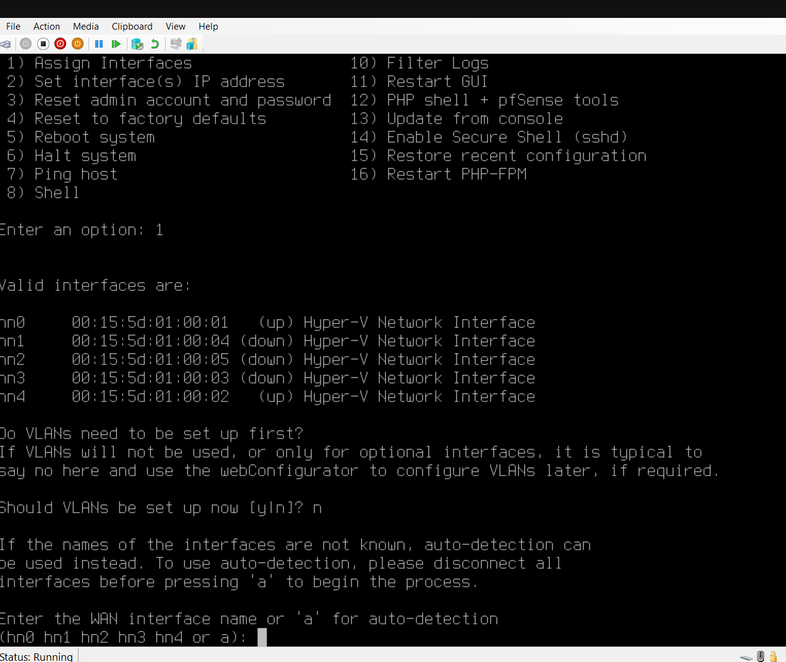

## Checkpoint 3 — Assignment summary reviewed
I entered WAN hn0, LAN hn4, OPT1 hn3, OPT2 hn1 and OPT3 hn2. The proposed assignment summary matches the five-zone plan. The corrected screenshot is paused at the proceed prompt with a blank input field; this is not evidence that the configuration has been applied. The earlier screenshot was superseded at the same evidence path to avoid duplicate publication.

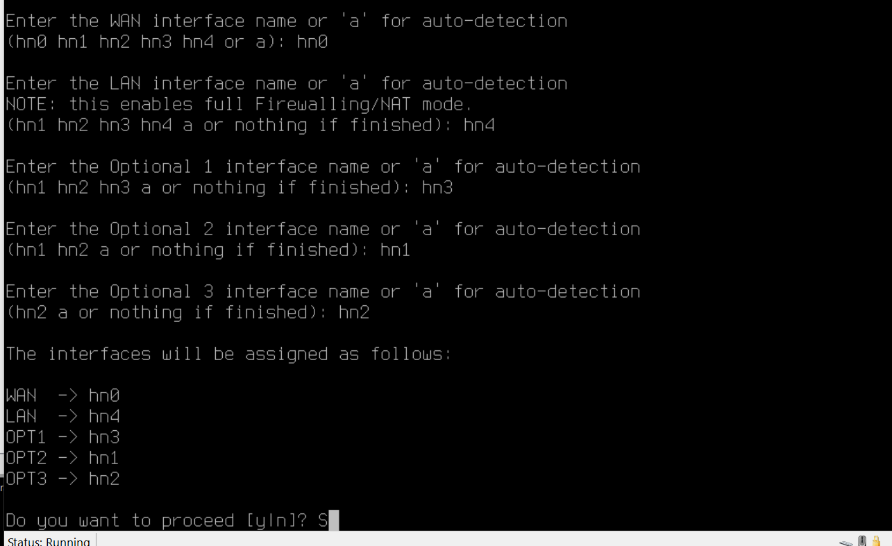

## Checkpoint 4 — Applied assignments verified
After confirming the assignment, I returned to the console menu. The resulting interface list verifies WAN hn0, LAN hn4, OPT1 hn3, OPT2 hn1 and OPT3 hn2. WAN retains DHCP address 172.28.254.188/20 and LAN retains 10.10.10.1/24. OPT1, OPT2 and OPT3 have no displayed IP addresses yet. This verifies interface assignment, not client connectivity or firewall-policy enforcement.

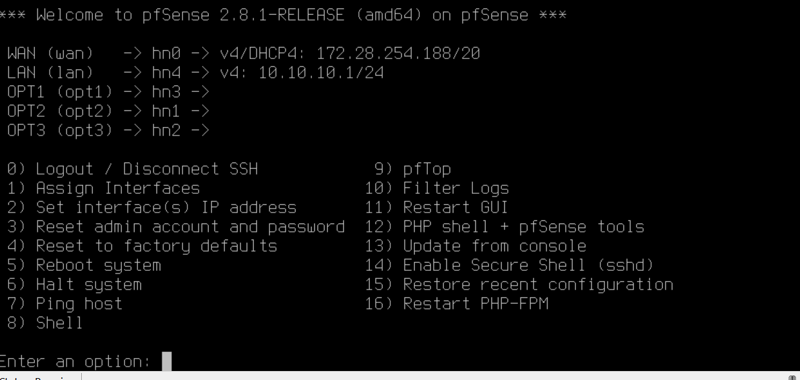

## Checkpoint 5 — SOC interface selection
I opened console option 2 and verified the displayed interface numbers: WAN/hn0 is 1, LAN/hn4 is 2, OPT1/hn3 is 3, OPT2/hn1 is 4 and OPT3/hn2 is 5. The screenshot is paused before selecting an interface. No SOC IP address has been entered or verified yet.

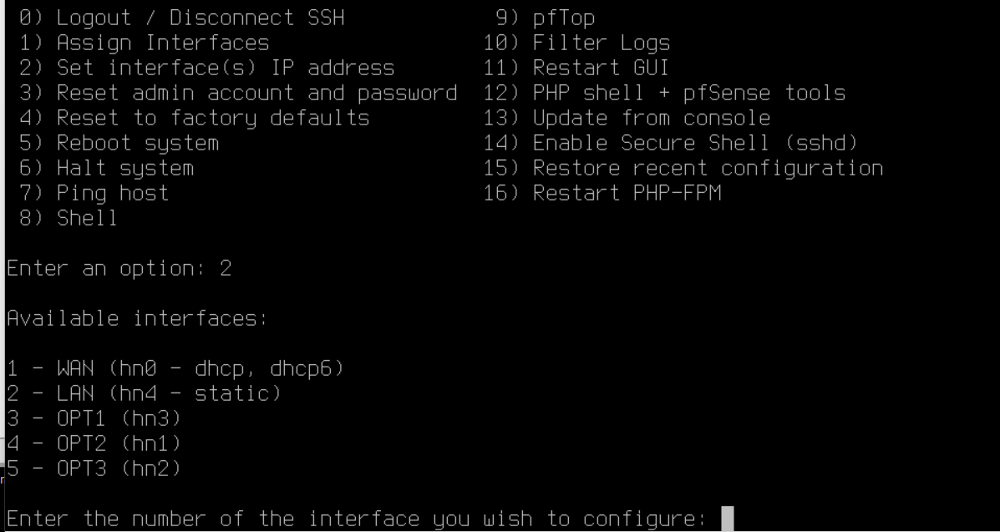

## Checkpoint 6 — SOC static IPv4 values entered
I selected interface 3 (OPT1/hn3), declined DHCP for its IPv4 address, entered 10.10.20.1 with prefix 24, and left the upstream gateway blank because SOC is an internal network. The console is paused at the DHCP6 question. These are entered values; completion and applied addressing still require subsequent evidence.

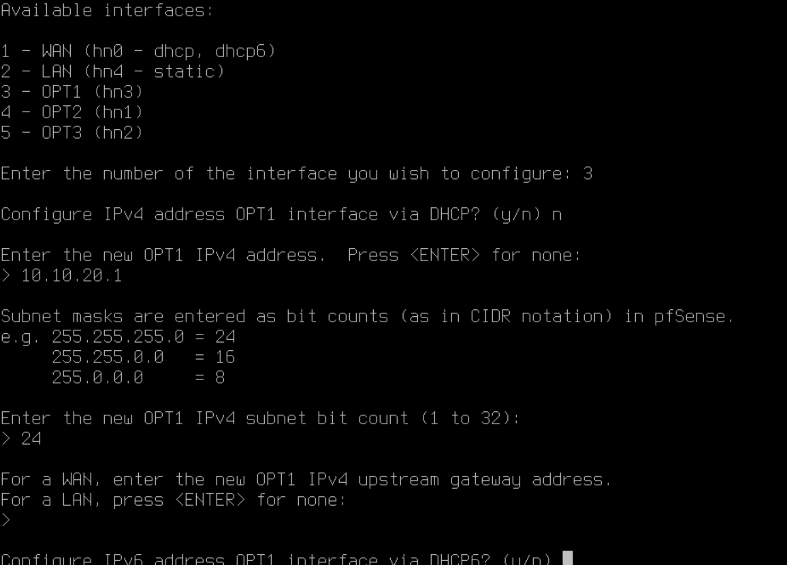

## Checkpoint 7 — SOC IPv4 configuration saved
I declined DHCP6, left the IPv6 address blank, disabled DHCP service on OPT1 and retained HTTPS. pfSense reloaded the filter and routing configuration, then explicitly confirmed that OPT1 was set to 10.10.20.1/24. This verifies the saved interface address; no client connectivity, webConfigurator reachability or segmentation-policy tests have been performed.

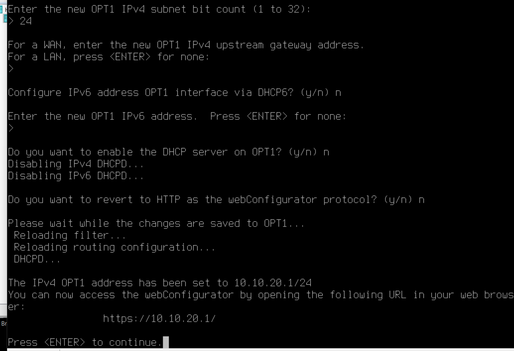

## Checkpoint 8 — CLINICAL IPv4 configuration saved
I configured OPT2/hn1 for the CLINICAL network. The console confirms 10.10.30.1/24 was saved after filter and routing reloads. The screenshot shows no upstream gateway, no IPv6 address, DHCP service disabled and HTTPS retained. The displayed webConfigurator URL is configuration output, not evidence of successful browser access or client connectivity.

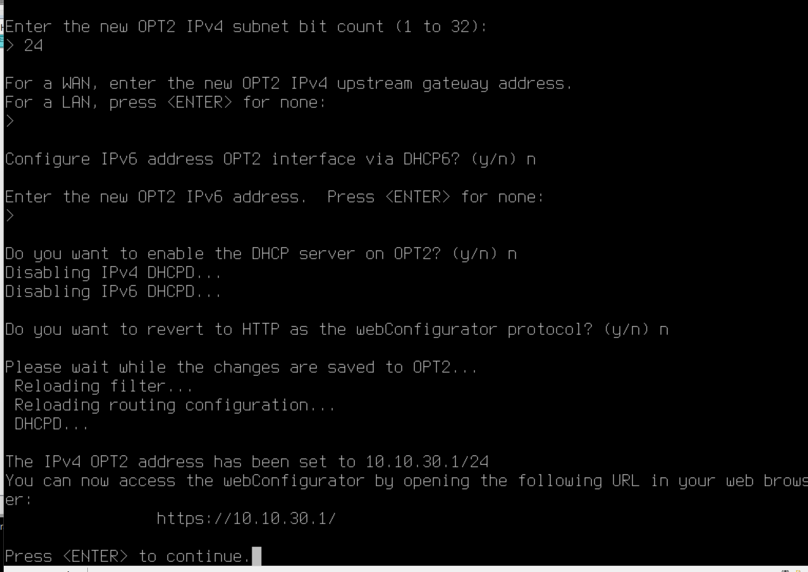

## Checkpoint 9 — ATTACK IPv4 configuration saved
The console explicitly confirms OPT3 was set to 10.10.40.1/24 after configuration reloads. This completes the planned internal gateway addressing: CORP 10.10.10.1/24, SOC 10.10.20.1/24, CLINICAL 10.10.30.1/24 and ATTACK 10.10.40.1/24. This cropped confirmation does not show the DHCP or IPv6 answers; those settings are not independently verified here. The displayed HTTPS URL is not proof of successful web access.

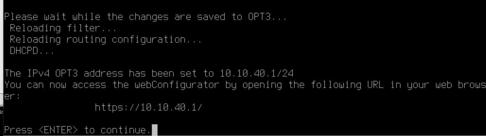

## Checkpoint 10 — Consolidated interface and address verification
I returned to the console menu and verified all five mappings and their current IPv4 addresses together.

| Role | Interface | Verified IPv4 |
|---|---|---|
| WAN | hn0 | DHCP 172.28.254.188/20 |
| CORP / LAN | hn4 | 10.10.10.1/24 |
| SOC / OPT1 | hn3 | 10.10.20.1/24 |
| CLINICAL / OPT2 | hn1 | 10.10.30.1/24 |
| ATTACK / OPT3 | hn2 | 10.10.40.1/24 |

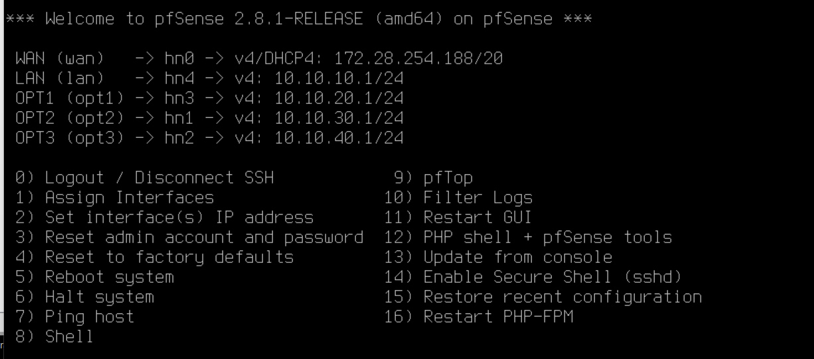

## Next procedure — CORP management access
Create CORP-WS01 using the downloaded Ubuntu Desktop 24.04 LTS AMD64 ISO. Attach the management client to MED-CORP-SW, then validate its address and access to https://10.10.10.1/. Internal switches remain Private, so direct host access is not assumed. No client VM, browser access or policy enforcement is verified by the firewall console.

## Checkpoint 11 — Management operating system selected (2026-10-11)
I selected Ubuntu Desktop 24.04 LTS as the free operating system for CORP-WS01, replacing the Windows management-client plan. I confirmed the ISO download in conversation. The exact ISO filename, checksum, VM creation, installation and browser access have not yet been verified. The architecture map and asset plan reflect this selection; no download screenshot was supplied.

## Remaining validation
- Establish a controlled management path; verify client DHCP, DNS and approved egress.
- Test allowed and denied inter-zone flows; export a configuration backup and validate recovery.

## Publication and privacy
Eleven screenshots have been reviewed for privacy. The first three have host labels and the Netgate device identifier masked; P2-04 through P2-11 contain no visible personal information or sensitive identifiers and required no redaction. Deliberately assigned lab MACs and private lab addressing remain for reproducibility. Each screenshot appears once in this journal; other documentation links here rather than duplicating images.

## Project documentation summary
I reviewed my clean-install checkpoint, verified pfSense startup and the existing WAN/CORP addressing, and correlated all five guest interfaces with the static lab MAC plan. I declined VLAN setup because the planned zones use separate virtual adapters. I entered the five interface names and reviewed the proposed summary against the zone plan. I subsequently verified all five applied assignments at the console, with WAN and CORP addressing preserved. I configured and saved SOC/OPT1 at 10.10.20.1/24 with DHCP disabled and HTTPS retained. I also saved CLINICAL/OPT2 at 10.10.30.1/24 with DHCP disabled and HTTPS retained. I verified the ATTACK/OPT3 save confirmation at 10.10.40.1/24, completing the internal address plan. Management access and segmentation enforcement remain untested.
