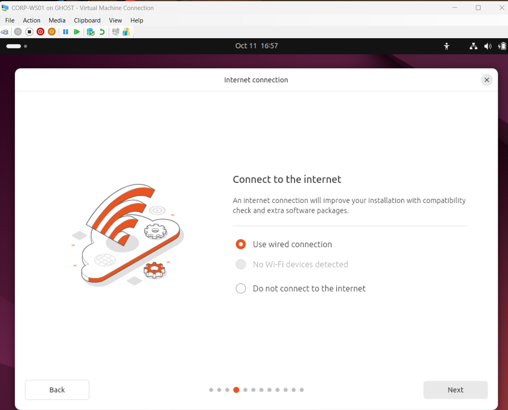
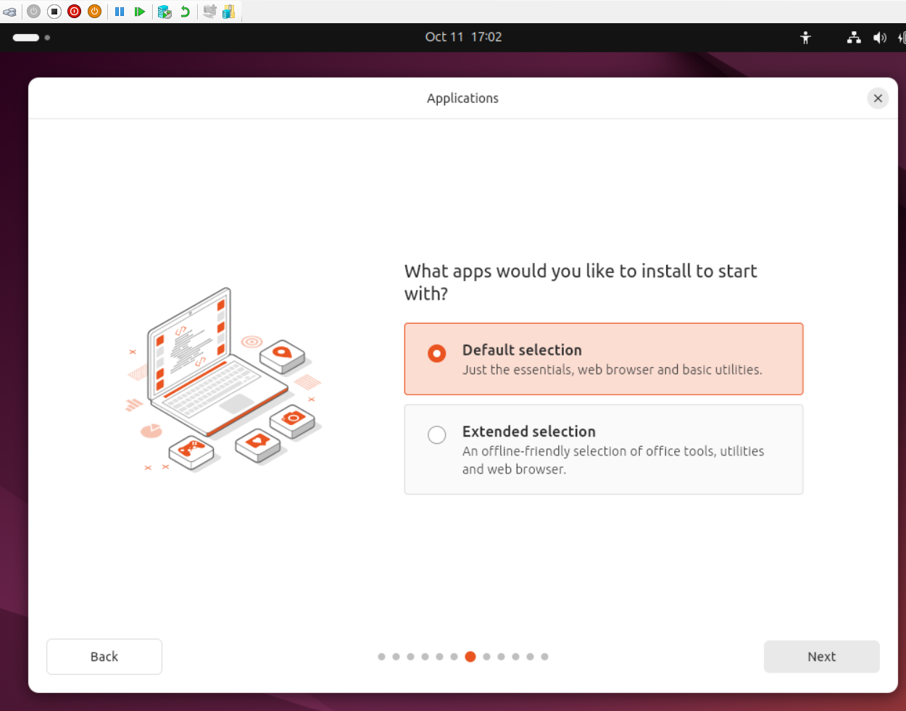
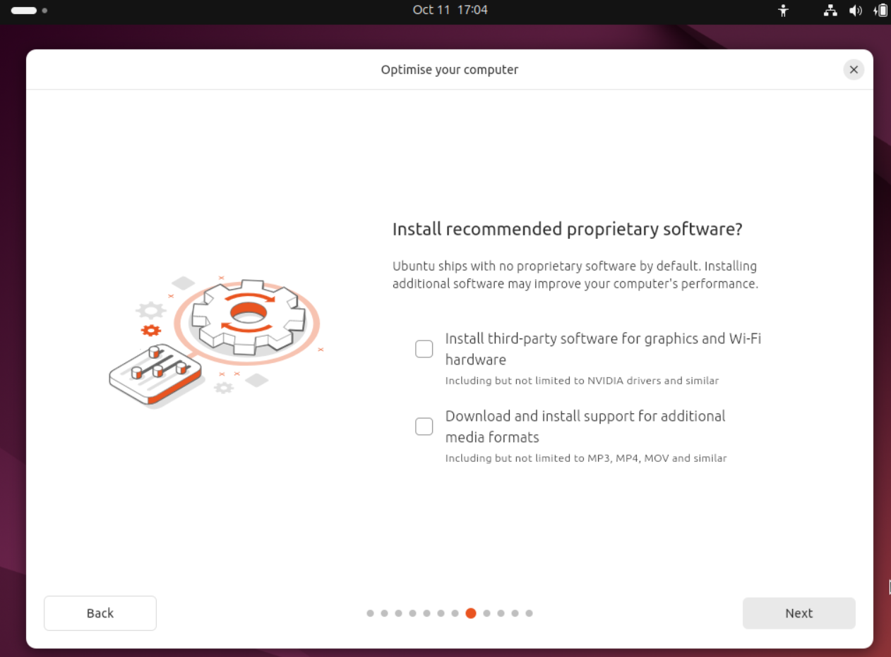
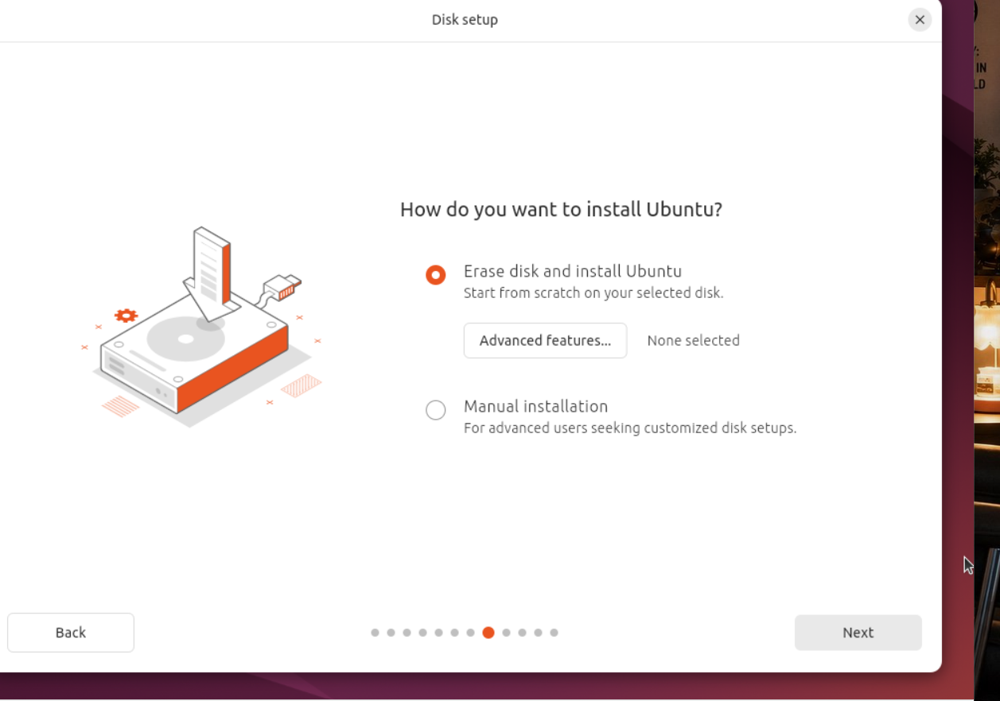
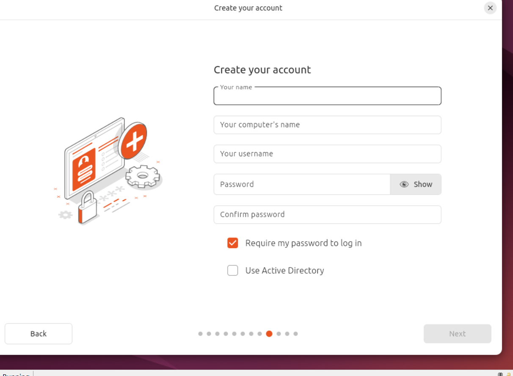
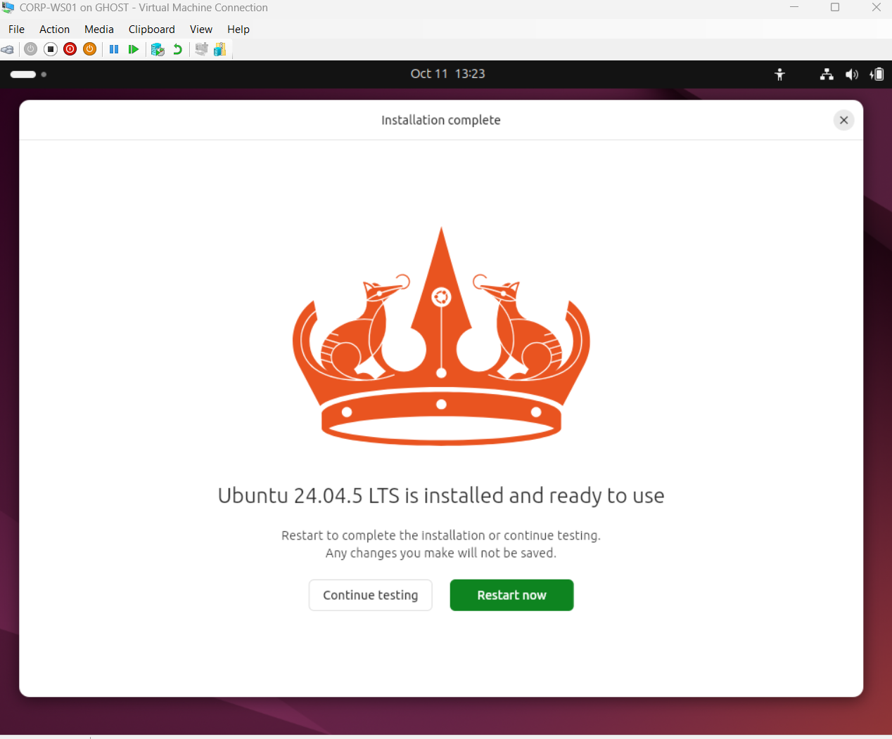
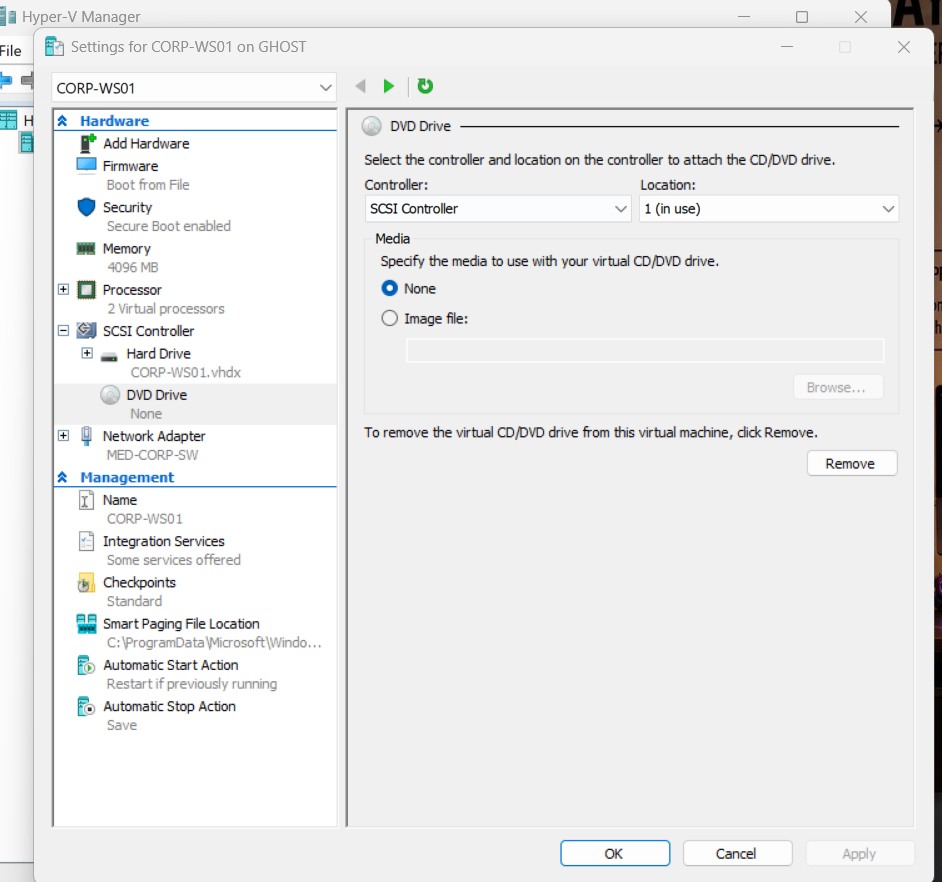
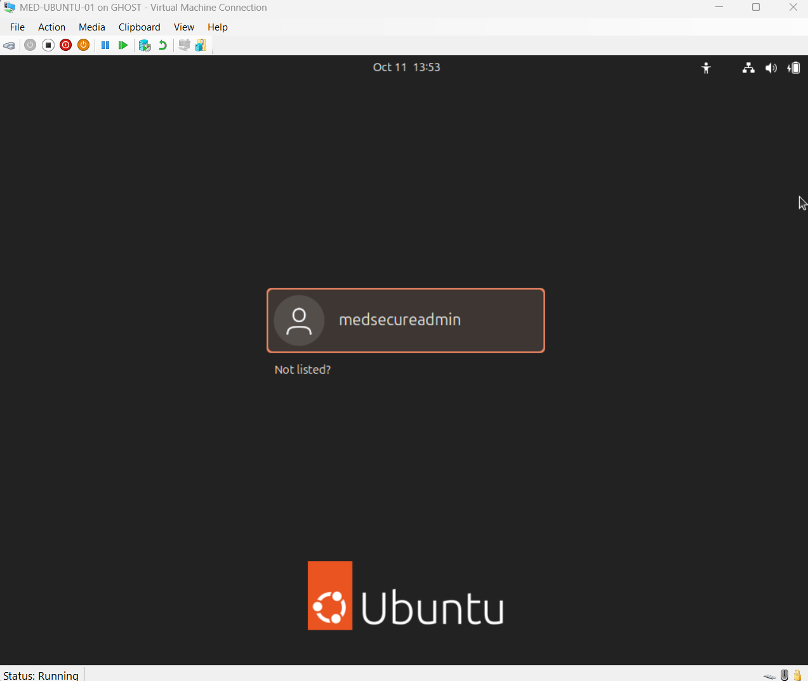
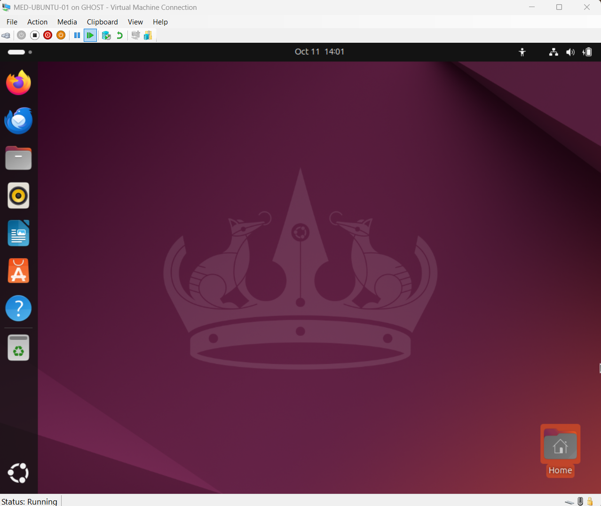

# Ubuntu Endpoint Deployment — October 11, 2026

## Milestone: installed and booted

I deployed **Ubuntu Desktop 24.04.5 LTS** in Microsoft Hyper-V as the Linux management and security-testing endpoint for MedSecure SOC. The VM was initially named `CORP-WS01` and was renamed to **`MED-UBUNTU-01`** in Hyper-V.

### Observed configuration
| Component | Evidence-based state |
|---|---|
| Hypervisor | Microsoft Hyper-V on host GHOST |
| Hyper-V VM | MED-UBUNTU-01 (formerly CORP-WS01) |
| Operating system | Ubuntu Desktop 24.04.5 LTS |
| Virtual network | MED-CORP-SW (private CORP switch) |
| Resources | 4096 MB RAM, 2 virtual processors (Hyper-V settings screenshot) |
| Installer | Default application selection; optional third-party drivers/media codecs not selected |
| Disk installation | Automatic erase/install option selected for VM virtual disk |
| Login | Local user `medsecureadmin`; password required; Active Directory option not selected |
| Installation medium | Hyper-V DVD Drive set to **None** following installation |
| Boot status | Ubuntu login screen and desktop shown; VM running |

### Verification boundaries
The screenshots verify installation completion, login-screen availability, desktop access, VM rename, and detached ISO. They **do not yet verify** the guest OS hostname, network IP, DHCP, routing, DNS, internet access, pfSense GUI reachability, hardening, or SIEM forwarding. The Hyper-V VM display name is not necessarily the Linux guest hostname.

### Next session — one step at a time
1. Open Ubuntu terminal and run `hostnamectl` to confirm the guest hostname and OS.
2. Run `ip -br a` and `ip route` to inspect CORP networking.
3. Test reachability to pfSense CORP gateway `10.10.10.1`; troubleshoot DHCP/policy if needed.
4. Apply updates after confirming network access; then plan hardening, audit logging and SOC telemetry.
5. Capture sanitized screenshots and update verification evidence.

### Portfolio summary (first person)
I installed and booted Ubuntu 24.04.5 LTS in Hyper-V, renamed the VM MED-UBUNTU-01, disconnected installation media, and verified access to the Ubuntu desktop. I am preparing the endpoint for controlled network connectivity, Linux security hardening and integration with the MedSecure SOC monitoring environment.

## Published screenshot evidence

Nine installation and boot screenshots are committed below. The VM creation, Secure Boot and VHDX setup screenshots are already published under `evidence/phase-02/03-management-workstation/`.

### P2-18 — Installer network selection (connectivity not yet verified)

### P2-19 — Default application selection

### P2-20 — Optional third-party software left unchecked

### P2-21 — Automatic installation on the VM virtual disk

### P2-22 — Account options before account details were entered

### P2-23 — Ubuntu 24.04.5 LTS installation complete

### P2-24 — Installation ISO detached: DVD drive set to None

### P2-25 — MED-UBUNTU-01 login screen

### P2-26 — MED-UBUNTU-01 Ubuntu desktop

